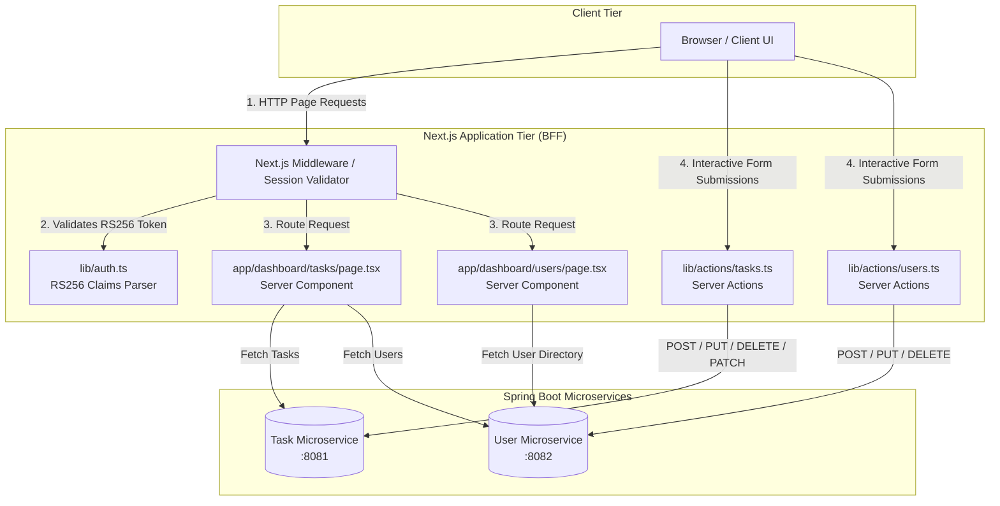
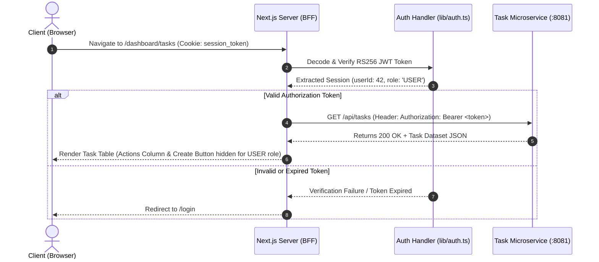
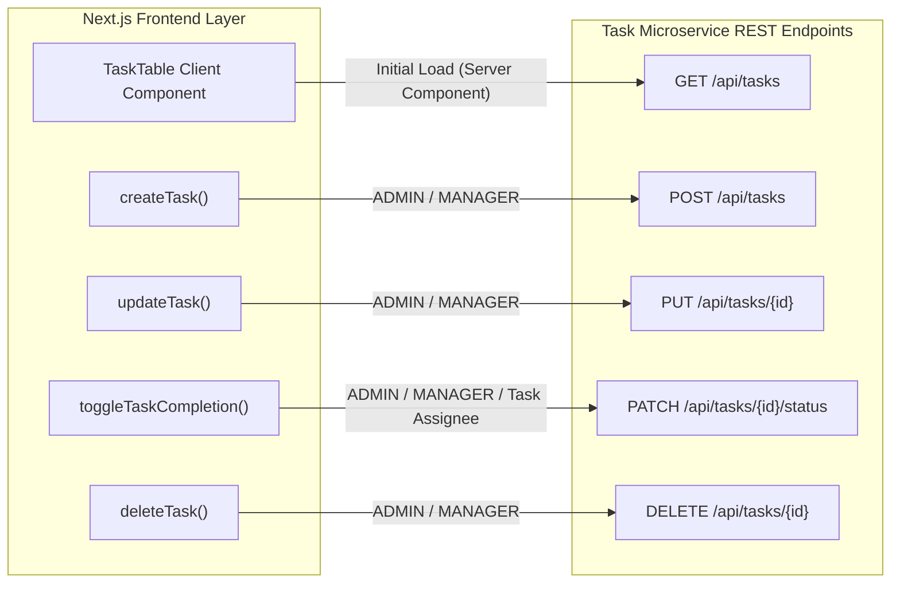
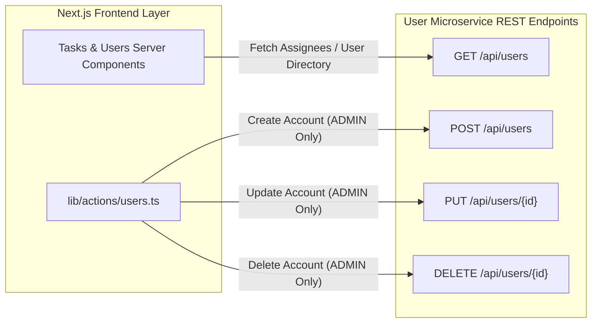
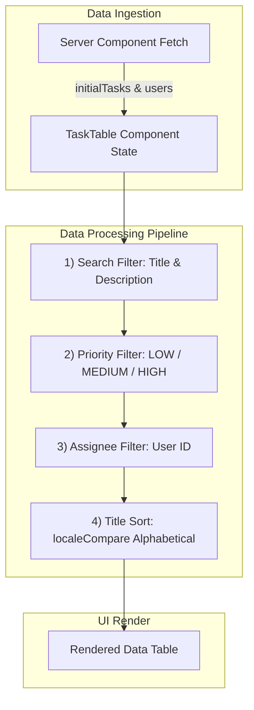
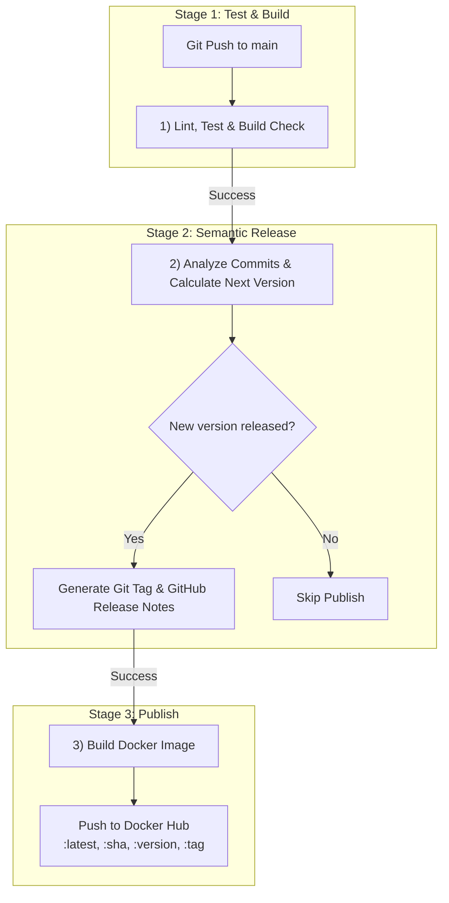

# Task Management Portal

The Task Management Portal is built using a Backend-for-Frontend (BFF) architecture with Next.js App Router, Tailwind CSS, and TypeScript. It communicates with two distributed Spring Boot microservices (`TASK_SERVICE_URL` and `USER_SERVICE_URL`) using asymmetric RS256-signed JSON Web Tokens (JWT) for authentication and Role-Based Access Control (RBAC).

---

## 1. High-Level System Architecture



---

## 2. Key Features

### 📋 Task Registry (`/dashboard/tasks`)

- **Real-time Task Overview**: Displays task title, description, priority badge, assignee name, completion status, and available actions.
- **Search & Multi-Filter**:
  - **Search**: Instant text search across task titles and descriptions.
  - **Priority Filter**: Filter tasks by `LOW`, `MEDIUM`, or `HIGH` priority.
  - **Assignee Filter**: Filter tasks by assignee (Admins and Managers only).
- **Automatic Sorting**: Tasks are automatically sorted in alphabetical order by title (`localeCompare`).
- **Interactive Completion Toggle**: Clickable status toggle for instant completion updates.
- **Role-Restricted Assignees**: Task creation and editing dropdowns filter and present only accounts with the `USER` role, sorted alphabetically.

### 👤 User Directory (`/dashboard/users`)

- **Account Administration**: Administrator-only view to create, edit, and delete system user accounts.
- **Strict Validation Rules**: Client-side and server-side validation for full name, username patterns (`[a-z0-9]+`), password lengths, and system roles (`ADMIN`, `MANAGER`, `USER`).
- **Alphabetical Sorting**: User listings are sorted alphabetically by full name.

---

## 3. Authentication & Authorization Sequence (RS256 JWT)

Authentication relies on RS256 asymmetric signatures (Public/Private key pair). The Next.js server verifies token signatures and extracts session claims (`userId`, `username`, `role`) before executing Server Actions or rendering components.



---

## 4. Microservice REST API Integration

### 4.1 Task Microservice (`TASK_SERVICE_URL`)



#### Endpoint Definitions

| Endpoint                 | Method   | Required Role                  | Payload / Constraints                      | Description                                  |
| ------------------------ | -------- | ------------------------------ | ------------------------------------------ | -------------------------------------------- |
| `/api/tasks`             | `GET`    | `ADMIN`, `MANAGER`, `USER`     | None                                       | Retrieves task list accessible to user role. |
| `/api/tasks`             | `POST`   | `ADMIN`, `MANAGER`             | `{ title, description, priority, userId }` | Creates task assigned to a `USER` account.   |
| `/api/tasks/{id}`        | `PUT`    | `ADMIN`, `MANAGER`             | `{ title, description, priority, userId }` | Updates task metadata or reassignment.       |
| `/api/tasks/{id}/status` | `PATCH`  | `ADMIN`, `MANAGER`, Task Owner | `{ completed: boolean }`                   | Toggles completion status.                   |
| `/api/tasks/{id}`        | `DELETE` | `ADMIN`, `MANAGER`             | None                                       | Removes a task record.                       |

---

### 4.2 User Microservice (`USER_SERVICE_URL`)



#### Endpoint Definitions

| Endpoint          | Method   | Required Role      | Payload / Constraints                                                                                     | Description                                     |
| ----------------- | -------- | ------------------ | --------------------------------------------------------------------------------------------------------- | ----------------------------------------------- |
| `/api/users`      | `GET`    | `ADMIN`, `MANAGER` | None                                                                                                      | Fetches directory of system user accounts.      |
| `/api/users`      | `POST`   | `ADMIN`            | `name` (2-50 chars), `username` (`[a-z0-9]+`), `password` (8-72 chars), `role` (`ADMIN`/`MANAGER`/`USER`) | Registers a new user account.                   |
| `/api/users/{id}` | `PUT`    | `ADMIN`            | Same constraints as `POST` endpoint                                                                       | Modifies existing user account details or role. |
| `/api/users/{id}` | `DELETE` | `ADMIN`            | Path variable `{id}`                                                                                      | Removes a system user account.                  |

---

## 5. Client Data Processing Pipeline

Tasks and user dropdowns undergo in-memory filtering and sorting prior to rendering:



---

## 6. Role-Based Access Control (RBAC)

The application enforces strict RBAC across UI components, Server Actions, and backend API endpoints for both Task Management and User Management.

### Task Management RBAC

| Action / Feature               |  `ADMIN`  | `MANAGER` |     `USER`     |
| :----------------------------- | :-------: | :-------: | :------------: |
| **View Task Registry**         | All Tasks | All Tasks | All / Filtered |
| **Search & Priority Filter**   |    Yes    |    Yes    |      Yes       |
| **Filter by Assignee**         |    Yes    |    Yes    |       No       |
| **Toggle Task Completion**     | Any Task  | Any Task  | Own Tasks Only |
| **Create New Task**            |    Yes    |    Yes    |       No       |
| **Edit Task / Reassign Owner** |    Yes    |    Yes    |       No       |
| **Delete Task**                |    Yes    |    Yes    |       No       |
| **Actions Column Visibility**  |  Visible  |  Visible  |   **Hidden**   |

### User Management RBAC (`/dashboard/users`)

| Action / Feature                               | `ADMIN` |   `MANAGER`   |    `USER`     |
| :--------------------------------------------- | :-----: | :-----------: | :-----------: |
| **Access User Directory (`/dashboard/users`)** | Allowed | Access Denied | Access Denied |
| **View System User List**                      |   Yes   |      No       |      No       |
| **Search User Accounts**                       |   Yes   |      No       |      No       |
| **Create New User**                            |   Yes   |      No       |      No       |
| **Edit User Account / Role**                   |   Yes   |      No       |      No       |
| **Delete User Account**                        |   Yes   |      No       |      No       |

---

## 7. CI/CD Pipeline Architecture

The application uses a 3-stage GitHub Actions workflow (`.github/workflows/ci.yml`) that automates code verification, semantic versioning, and container image publishing. The Publish stage runs only when the Semantic Release stage publishes a new version; if no releasable commits are found, the pipeline ends after Stage 2.



Refer to the deployment workflow [here](deployment.md) for details.

> **Deployment**: The application is deployed on Vercel, which is handled separately and is not part of this workflow. The former Railway deployment job (Stage 4) has been disabled in `ci.yml` due to a security incident.

## 8. Tech Stack

- **Frontend Framework**: [Next.js 15+](https://nextjs.org/) (App Router, React Server Components, Server Actions)
- **Styling & UI**: [Tailwind CSS](https://tailwindcss.com/), [Lucide React Icons](https://lucide.dev/)
- **Language**: TypeScript
- **Backend Ecosystem**: Spring Boot Java Microservices (Task Service & User Service)
- **Authentication**: RS256-signed JWTs (Asymmetric Public/Private Key verification with session claims parsing)

---

## 9. Project Architecture & Directory Structure

```text
├── app/
│   ├── dashboard/
│   │   ├── tasks/
│   │   │   ├── page.tsx          # Server Component: Fetches tasks & users
│   │   │   └── task-table.tsx    # Client Component: Filtering, sorting, CRUD modals
│   │   └── users/
│   │       ├── page.tsx          # Server Component: Fetches user directory
│   │       └── user-table.tsx    # Client Component: User management modal & table
│   └── login/
│       └── page.tsx              # Authentication entry point
├── lib/
│   ├── actions/
│   │   ├── tasks.ts              # Server actions for task microservice REST endpoints
│   │   └── users.ts              # Server actions for user microservice REST endpoints
│   └── auth.ts                   # RS256 JWT token verification & claim extraction
├── .env.local                    # Local environment variables (git-ignored)
└── package.json
```

---

## 10. Getting Started

### Prerequisites

- **Node.js**: `v18.17.0` or higher
- **Package Manager**: `npm`, `yarn`, or `pnpm`
- **Backend Services**: Active instances of the Task Microservice and User Microservice providing public key verification endpoints or JWKS for RS256 validation.

### 1. Environment Configuration

Create a `.env.local` file in the root directory of the Next.js project:

```env
# Microservice REST Endpoints
TASK_SERVICE_URL=http://localhost:8081
USER_SERVICE_URL=http://localhost:8082

```

> **Note**: If you modify `.env.local` while the development server is active, restart the dev server for Next.js to register updated environment variables.

### 2. Installation

Install project dependencies:

```bash
npm install

```

### 3. Run Development Server

Clear any stale cache and launch the development server:

```bash
# Optional: Clear Next.js build cache if environment variables changed
rm -rf .next

# Start development server
npm run dev

```

Open [http://localhost:3000](http://localhost:3000) in your browser to view the application.

---

## 11. Form Validation Standards

To ensure data integrity between the Next.js frontend and the Java Spring Boot backend DTOs, the following validation constraints are enforced:

### Task Form Validation

- **Title**: Required (`@NotBlank`)
- **Priority**: Required (`LOW`, `MEDIUM`, `HIGH`)
- **Completed**: Boolean (`true` / `false`)
- **Assignee (`userId`)**: Required (`@NotNull Long userId`), must belong to a user with the `USER` role.

### User Form Validation

- **Full Name**: 2 – 50 characters
- **Username**: 6 – 20 lowercase alphanumeric characters (`pattern="[a-z0-9]+"` required)
- **Password**: 8 – 72 characters
- **Role**: Required (`ADMIN`, `MANAGER`, `USER`)
